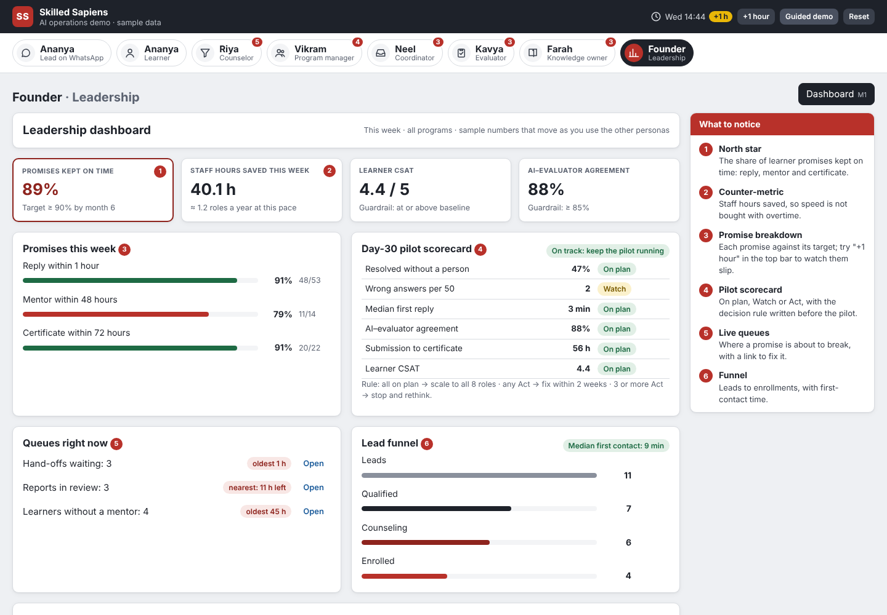

# Skilled Sapiens AI Ops Demo

A clickable demo of the AI operations plan proposed for Skilled Sapiens (Live Project 1: *AI Product Strategy for Operational Optimization*). Eight personas share one learner record, so an action taken as one persona shows up for the others. For example, a question a learner asks lands in the coordinator's inbox, and an evaluator's approval puts a certificate on the learner's page.

**Sample data only.** No real learners, leads, mentors or policies are used. AI responses are simulated in the browser, and nothing is sent anywhere.



## Try it

- **Online:** after you publish it (see below), the demo lives at `https://<your-github-username>.github.io/skilled-sapiens-ai-ops-demo/`.
- **On your computer:** double-click `index.html`. It needs no install, no build and no internet.
- **Progress:** saved in your browser. **Reset** in the top bar starts the story again.

## Publish on GitHub Pages (about 10 minutes)

> **GitHub does not unzip files.** If you upload the .zip itself, the site won't work. Unzip it on your computer first, then upload what's inside.

1. Create a new **public** repository on GitHub named `skilled-sapiens-ai-ops-demo`. Leave "Add a README" off. Pages on private repositories needs a paid plan.
2. On the empty repository page, click **uploading an existing file**. Select everything *inside* the unzipped folder (`index.html`, `README.md`, `css`, `docs`, `js`) and drag it in, so that `index.html` sits at the top level. Then click **Commit changes**. Or use git:
   ```bash
   git init && git add . && git commit -m "Skilled Sapiens AI ops demo v1"
   git branch -M main
   git remote add origin https://github.com/<your-github-username>/skilled-sapiens-ai-ops-demo.git
   git push -u origin main
   ```
3. Turn on Pages:
   1. In the repository, open **Settings → Pages**.
   2. Under **Build and deployment**, set the source to **Deploy from a branch**.
   3. Choose branch **main** and folder **/ (root)**, then **Save**.
4. Wait about a minute, refresh the Pages settings, and open the link it shows.

The empty `.nojekyll` file tells GitHub Pages to serve the files exactly as they are.

## 10-minute demo script

Click **Guided demo** in the top bar. The panel walks through these 12 steps, and you can jump to any of them: earlier steps are completed for you.

| # | Persona | What to do | What it shows |
|---|---|---|---|
| 1 | Ananya (lead) | Tap Yes → Summer placements → Product → Within 4 weeks | Consent first; the lead lands in the CRM as High fit |
| 2 | Riya, counselor | Open Ananya's card, click **Call**, then **Mark paid and enrolled** | One board for every lead; 15-minute clock |
| 3 | Vikram, program manager | Read the AI brief, confirm the top mentor | AI suggests, a person decides; the 48-hour promise |
| 4 | Ananya (learner) | See Home; click **Skip ahead 3 weeks** | Progress, next session and promises in one place |
| 5 | Vikram | **Recaps to check** → publish week 3 | AI recap, checked by a person |
| 6 | Ananya | In **Ask Sapiens**, tap the group-submission question, then the extension request | Sourced answer vs. clean hand-off |
| 7 | Neel, coordinator | Send the suggested reply | Only what AI can't settle reaches a person |
| 8 | Ananya | **Project** → **Use the sample file** | Own-account upload; group copies matched |
| 9 | Kavya, evaluator | Change one score, then **Approve** | AI draft, human grade, certificate on approval |
| 10 | Ananya | **Project** → **Verify** | Certificate with ID and feedback |
| 11 | Farah, knowledge owner | Answer the top open question | The gap closes; Ask Sapiens can answer it now |
| 12 | Founder | Open the dashboard; press **+1 hour** | Promises kept, hours saved, queues and the pilot scorecard |

Things to try off-script:
- Ask Sapiens "Who is my mentor?" or "How do I verify my certificate?"
- Mark an answer **Wrong** and watch the scorecard.
- Review the overdue "Extensions" page in One Source.
- Press **+1 hour** a few times to see timers and promises slip.

## How it works

There's no framework and no build step: plain HTML, CSS and JavaScript, loaded as classic scripts so the demo also runs from `file://`.

```
index.html            page shell, loads the scripts in order
css/styles.css        all styles
js/data.js            ALL sample content: leads, learners, mentors, KB pages, reports, recaps
js/store.js           state, saving to localStorage, every action that changes data (App.do.*), dashboard metrics
js/ai.js              simulated AI: answers, hand-offs, mentor ranking (swap for real services later)
js/ui.js              small helpers: chips, buttons, phone frame, toasts, icons
js/views/*.js         one file per persona; each returns HTML and registers its button actions
js/guide.js           the 12-step guided demo
js/app.js             personas, routing (#/persona/screen), rendering, events
docs/PRD.pdf          the product requirements for Skilled Sapiens, with wireframes
docs/PRD.md           a text version of the PRD
```

**The pattern.**
1. A view returns HTML.
2. Buttons carry `data-action="name"`.
3. `app.js` calls `App.actions[name]`.
4. The action calls `App.do.something()` in `store.js`, then `App.commit()`, which saves and re-renders.

**Common changes**
- **Change wording or sample data:** edit `js/data.js`. If you change its shape, bump `App.SEED_VERSION` so browsers drop their saved copy.
- **Add a knowledge-base answer:** add an entry to `kb` in `js/data.js` with a few `keywords`.
- **Add a screen:**
  1. Add a function to a view file.
  2. Add it to the persona's `screens` list in `js/app.js`.
- **Make the AI real:** keep the function names in `js/ai.js` and call a serverless endpoint from inside them. Never put API keys in the browser. The PRD's "What the demo simulates" section lists the production tool for each part.

## Limits

- It's a demo for discussion, not a live system: no logins, no backend, no real AI.
- Progress is stored in this browser only. It isn't shared between people or devices.
- Policies such as refunds, extensions and LORs are placeholders until Skilled Sapiens confirms them.

---

Built by Subhranil Hazra for the Skilled Sapiens Live Project, October 2026.
